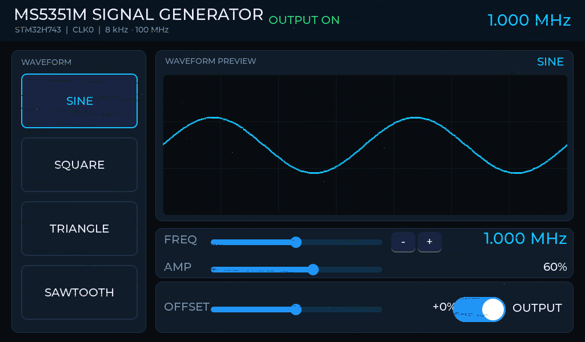

# MS5351M 函数信号发生器（正点原子阿波罗 H7 / STM32H743IIT6）

SDRAM 帧缓存 + LTDC 直驱 1024×600 RGB 屏，LVGL 9.6.0 全屏界面，GT911 电容触摸，
MS5351M 作为时钟源。工程说明与调试结论一并存档于此。



> 上面这张是**实机画面**，由 LTDC 帧缓存 `0xC0000000` 经 SWD 在线 dump 后按 RGB565 转成 PNG，
> 不是设计稿。完整说明见 [`docs/工程说明.html`](docs/工程说明.html)。

## 当前状态

| 模块 | 状态 | 依据 |
| --- | --- | --- |
| 显示 | 正常 | `g_dbg.lvgl_ok=1`、`ui_ok=1`，实机截图核对 |
| 触摸 | 可用 | GT911 在 `0x14` 应答，产品 ID 读回 `"911"`，用户实机确认 |
| MS5351M 通信 | 正常 | 寄存器写入后回读一致，`si_ok=1` |
| MS5351M 输出 | **不可用（硬件）** | 参考晶振未起振，`reg0` bit7 SYS_INIT 卡在 1，见下文 |

## 快速开始

```powershell
# 1. 工具链进 PATH（切勿额外设置 GCC_PATH）
$env:Path="D:\arm-gnu-toolchain-14.2.rel1-mingw-w64-i686-arm-none-eabi\bin;D:\GNU MCU Eclipse\Build Tools\2.12-20190422-1053\bin;" + $env:Path

# 2. 编译（不要用根目录 CubeMX 生成的 Makefile）
cd E:\ms5351m
make -f Makefile.core -j8

# 3. 烧写
STM32_Programmer_CLI -c port=SWD mode=UR -w build_core\ms5351m_core.elf -v -rst

# 4. 读在线调试快照（地址每次用 nm 现查，会随代码漂移）
arm-none-eabi-nm build_core\ms5351m_core.elf | findstr " g_dbg"
STM32_Programmer_CLI -c port=SWD mode=hotplug -r32 0x200007E8 80

# 5. 抓屏：导出帧缓存再转 PNG
STM32_Programmer_CLI -c port=SWD mode=hotplug -u 0xC0000000 1228800 dump\fb_now.bin
python dump\fb2png.py
```

产物：`build_core/ms5351m_core.elf|.hex|.bin`（text 418792 / data 208 / bss 180432）。
VSCode 里 `Ctrl+Shift+B` 走 `.vscode/tasks.json` 的 build / clean / flash 任务。

> **为什么不用根目录的 `Makefile`**：CubeMX 生成的那份同时列了 `Src/` 与 `Core/Src/` 两套源文件，
> 两边 `syscalls.c` 都定义 `__env`，必然报多重定义；有时还会因为 `build/` 比源码新而输出
> `Nothing to be done for 'all'`。统一走 `Makefile.core` → `build_core/`。

## 硬件配置

| 部件 | 规格 | 接口 |
| --- | --- | --- |
| MCU | STM32H743IIT6（Cortex-M7 480 MHz） | — |
| LCD | 7 寸 RGB 1024×600，RGB565 | LTDC，帧缓存 `0xC0000000` |
| SDRAM | 32 MB，bank1 映射 `0xC0000000` | FMC，刷新率 1667 |
| 触摸 | GT911 | 软件 I2C（GPIO 位操作） |
| 时钟源 | MS5351M 模块 | 硬件 I2C1，地址 `0x60` |
| 调试 | ST-Link V2 / SWD | STM32CubeProgrammer CLI |

- 像素时钟：PLL3 M=1 N=6 P=2 Q=2 R=3 → **50 MHz**（`RCC_PLL3DIVR` 偏移 `0x40`，读回 `0x02010205`）
- SDRAM 上电序列 CubeMX 不生成，由 `Core/Src/main.c` USER CODE 2 手写：
  CLK_EN → 1 ms → PALL → AUTOREFRESH×8 → LOAD_MODE `0x0230` → `HAL_SDRAM_ProgramRefreshRate(&hsdram1, 1667)`

## 引脚

| 宏 | 引脚 | 用途 |
| --- | --- | --- |
| `T_SCK_Pin` | PH6 | GT911 SCL（位操作） |
| `T_SDA_Pin` | PI3 | GT911 SDA（位操作） |
| `T_INT_Pin` | PH7 | GT911 INT（轮询，新树无 RST 脚） |
| `LCD_BK_Pin` | PB5 | 背光使能 |
| `IIC_SCL_Pin` / `IIC_SDA_Pin` | PH4 / PH5 | CubeMX 原 I2C1，被释放为 ANALOG |
| （运行时探测） | PB6 / PB7 | I2C1 SCL/SDA（AF4），MS5351M 实际应答的一组 |
| `Switch_2` / `Switch_3` | PA3 / PA4 | 板载按键（PA4 占用 DAC1_OUT1） |
| `LED0` / `LED1` | PB1 / PB0 | 板载 LED |

MS5351M 实测**不在 PB8/PB7**（该组合整条总线无应答），在 **PB6=SCL / PB7=SDA**。
`ms5351_init()` 会依次尝试 PB8+PB7 → PB6+PB7 → PB8+PB9 三组，命中即锁定，
结果记在 `g_dbg.si_mask` bit24~26，换线不必改代码。

## 目录结构

```
E:\ms5351m
├─ Core/            CubeMX 生成，手写代码只写进 USER CODE BEGIN/END
├─ app/             全部手写逻辑（CubeMX 重新生成不会碰）
│  ├─ app.c/.h      总入口、g_dbg 调试快照、主循环
│  ├─ bsp_lcd.c/.h  MPU / PLL3 / LTDC / 图层 / flush / 整屏填充
│  ├─ siggen_ui.c   1024×600 全屏 LVGL 界面
│  ├─ ms5351.c/.h   时钟芯片驱动 + 锁相扫描 + 晶振直通诊断
│  ├─ i2c_bus.c/.h  I2C1 引脚重定位与自动探测
│  └─ gt911.c/.h    触摸驱动 + 后台重试
├─ lvgl/            LVGL 9.6.0 源码，一个字节都不改
├─ lv_conf.h        堆 0x30000000 / 256KB，PARTIAL 渲染，双 1024×40 draw buffer
├─ lvgl_files.mk    LVGL 源文件清单
├─ Makefile.core    唯一构建入口
├─ docs/            说明文档与实机截图存档
├─ dump/            帧缓存原件与 RGB565→PNG 脚本
└─ 显示调试结论.md   更细的现场记录
```

## 调试手段

**`g_dbg` 调试快照（18 个 u32）** —— 不开串口也能看全部状态：

| 字段 | 含义 |
| --- | --- |
| `magic` | `0x53504731`（"SPG1"），确认结构体地址没取错 |
| `lvgl_ok` / `flush_cnt` / `ui_ok` | LVGL 初始化、flush 次数、界面是否建好 |
| `touch_addr` | GT911 命中的 7 位地址（`0x14` = 就绪） |
| `touch_x` / `touch_y` | 最近触摸坐标 |
| `si_ok` / `si_lock` / `si_status` / `freq_hz` | 5351 在线、锁相、原始状态字节、目标频率 |
| `gt_id` | `0x8140` 产品 ID，实测 `0x39313100`（"911"） |
| `gt_ack` | bit20/21 SDA 驱动自检、bit22/23 SCL 自检、bit16~19 释放电平 |
| `si_mask` | bit0~3 负载电容、bit4~17 晶振×VCO 锁相结果、bit24~26 命中的 I2C 引脚对 |
| `gt_scan` / `gt_int_low` / `gt_pins` | 后台重试次数、INT 低电平计数、三线电平 |

**抓屏**：`-u 0xC0000000 1228800` 导出帧缓存 → `dump/fb2png.py` 转 PNG。
注意 `--upload` 长参数不可用，必须用 `-u`；读在线内存必须 `mode=hotplug`，`UR` 会复位清零。

**探针互斥**：调 OpenOCD / gdb 前先结束 `STM32_Programmer_CLI`，反之亦然。

## 调试结论（三条链路）

### 1. 屏上雪花 → 第二图层

帧缓存 dump 每次都是对的，屏上却是雪花。逐层排除（cache/MPU → LTDC 欠载计数 → CPU 纯色 /
关层 / DMA2D 隔离 → 用能正常显示的固件当金标准逐寄存器比对）之后，在面板端找到原因：

- LTDC **图层 2 在硬件中处于使能**（`0x50001104` 的 CR bit0 = 1），`CFBAR=0xC0200000` 指向一块
  从未绘制过的 SDRAM，alpha=255 全屏叠在图层 1 上 → 满屏雪花
- `__HAL_LTDC_LAYER_DISABLE()` 只改 RAM 结构体不写寄存器，所以从来没生效
- 正确做法：`LTDC_Layer2->CR = 0U; hltdc.Instance->SRCR = LTDC_SRCR_IMR;`
- 另一处差异：`HAL_LTDC_MspInit` 把 PLL3R 写回 5（25 MHz），覆盖了 50 MHz 设置

结论：`.ioc` 本身没问题，老工程这两处差异才是病因。

### 2. GT911 全地址无应答 → 上电等待不够

早期在 `app_init()` 里复位后只等 60 ms 就探测，0x08~0x77 全地址 NACK，看起来像接线错或芯片坏。
实际 GT911 上电后要等远超 100 ms 才第一次应答。现在：

- 位操作半周期 `GT911_DELAY_US = 20 µs`（约 25 kHz，7 寸 FPC 只靠内部上拉）
- `gt911_init()` 里 40×50 ms 轮询 → 仍不通再走 4 组复位/INT 组合兜底 → 读产品 ID 清状态
- `gt911_service()` 每 200 ms 后台重试探 + 采样三线电平 + 统计 INT 低电平
- `GT911_HAS_RST` 条件编译：新树没有 RST 脚，不对不存在引脚做 GPIO_Init

实测 `touch_addr = 0x14`、`gt_id = 0x39313100`、`gt_ack = 0x00FF0001`。

### 3. MS5351M PLL 始终不锁 → 参考晶振没起振（硬件）

寄存器写入后回读全部正确（`26~33 = 00 01 00 10 …`，P3=1、P1=4096 → 25 MHz×36 = 900 MHz 整数模式），
但 `reg0` 的 LOL_A 恒为 1。做了**单向判定**：编一版 `-DMS5351_XTAL_TEST=1` 的固件，
绕过 PLL 与 MultiSynth，让 CLK0 直接由晶振经 fanout 输出（`reg187=0x50`、`reg16=0x03`、`reg3=0xFE`）。

读回 `183/187/16/3/0/15 = 0x40/0x50/0x03/0xFE/0xE1/0x00`，配置确实落片，
但 **CLK0 没有任何波形，且 `reg0` bit7（SYS_INIT）卡在 1** —— 芯片自己在等参考时钟。

因此根因是**硬件层参考时钟缺失**：晶振虚焊/损坏、模块本就没焊晶振，或芯片内部 XO 坏。
之前示波器上 31.7 / 33.9k / 44k 的乱跳读数是 PLL 无参考未锁时的杂波，不能反推分频。

另外这块克隆片的状态位不可当判据：`reg0` bit3 会跟着 `reg183` bit7 一起翻，bit4 恒 0、bit5/6 恒 1。
界面文案已从 `PLL LOCKED` 改成 `OUTPUT ON / OFF`，真实状态只留在 `g_dbg.si_status / si_lock`。

**修复路径**

1. 10× 探头量模块 **XA** 脚：有 25 MHz 正弦摆幅 → fanout 配置问题；死平 → 晶振/芯片问题
2. 换带 25 MHz 晶振的 **SI5351A 正品模块**（驱动已有引脚自动探测，换模块不必改代码）
3. 救现有模块：STM32 MCO/TIM 出 25 MHz，经约 10 nF 耦合到 CLKIN/XA，`reg15` 写 `0x0C`
4. 换设计：H743 内置 DAC（`DAC1_OUT2 = PA5` 空闲）+ DMA 查表，覆盖约 0~100 kHz

## 已知问题与后续

- **MS5351M 参考晶振待硬件修复**。修好后无需改代码，驱动会重新扫 LOL_A 并在 `si_mask` 记结果；
  若实际晶振不是 25/27 MHz，需要把 `kXtal[]` 改成实测值。
- **波形/幅度/偏置是硬件限制**：MS5351M 是时钟发生器，只能出方波，没有幅度控制也没有直流偏置。
  界面上的 SINE / TRIANGLE / SAWTOOTH 与 AMP / OFFSET 对 CLK0 无实际作用，要真正实现必须加 DAC 与后级模拟链路。
- 界面右下 OUTPUT 开关与 OFFSET 数值文字有轻微重叠，属布局细节，在 `siggen_ui.c` 里调坐标即可。
- **CubeMX 重新生成前复查**：`STM32H743xx_FLASH.ld` 里的 `.ltdc_draw_buf (NOLOAD)` 段不在 USER CODE 区，
  重新生成会丢（丢了链接溢出）；生成后立刻读一次 `0x50001104`，若 CR bit0 又变 1，雪花会回来。

## 工程约定

- 不改 `lvgl/` 目录里任何文件，避免下一次生成或升级时被覆盖
- CubeMX 生成的 `.c/.h` 里，手写代码一律写在 `USER CODE BEGIN/END` 之间
- 新功能放 `app/`，新源文件加进 `Makefile.core` 的源列表

## 地址速查

| 对象 | 地址 / 值 |
| --- | --- |
| LTDC 图层 1 | `0x50001084` |
| LTDC 图层 2（雪花的元凶） | `0x50001104`，CR bit0 必须为 0 |
| PLL3 分频 | `0x58024440`，实测 `0x02010205` → 50 MHz |
| 帧缓存 | `0xC0000000`，1024×600 RGB565 = 1,228,800 字节 |
| FMC SDRAM | `0x52004140` / `0x52004148`（读 `0x39D9` / `0x01126361`）；`0x52004144` 是 bank2 SNCTL，不要写 |
| LVGL 堆 | `0x30000000`，256 KB（内部 D2 SRAM） |
| GT911 | `0x8140` 产品 ID、`0x814E` 状态（读完写 0 清标志） |

## 存档文件

| 文件 | 内容 |
| --- | --- |
| `docs/工程说明.html` | 完整图文工程说明（可直接用浏览器打开） |
| `docs/assets/ui-1024x600.png` | 实机界面截图 |
| `显示调试结论.md` | 更细的现场取证记录 |
| `dump/fb_now.bin` / `fb_now.png` | 帧缓存原件与转换结果 |
| `dump/fb2png.py` | RGB565 → PNG 转换脚本 |
| `build_core_log.txt` | 最近一次构建日志 |
